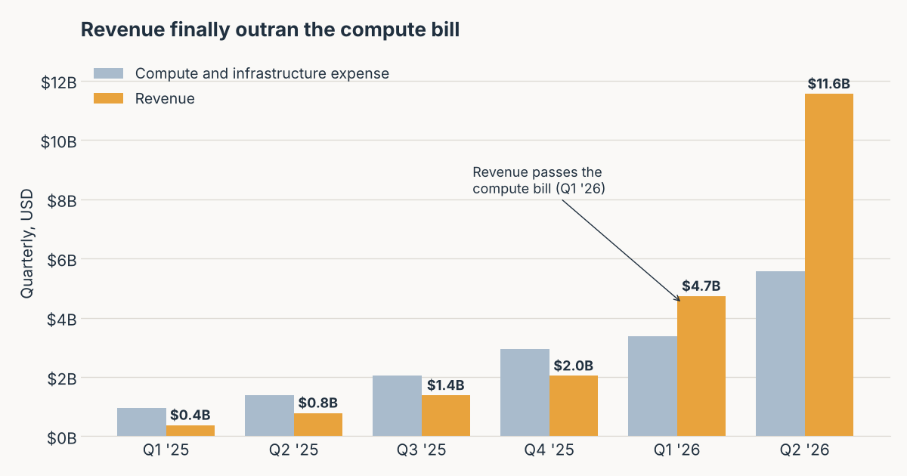
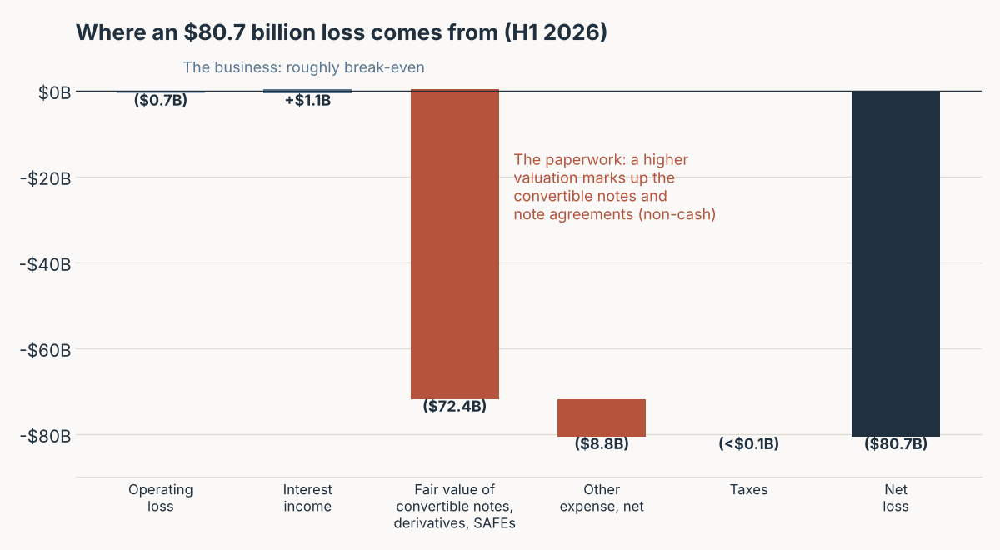
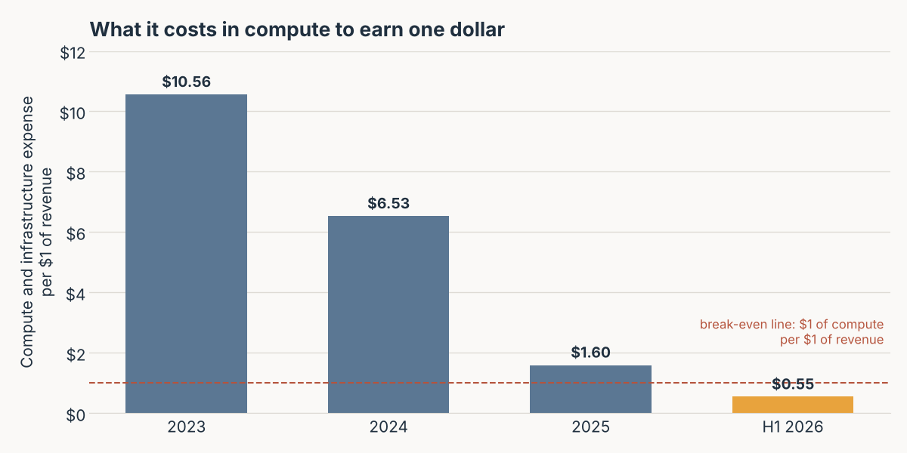
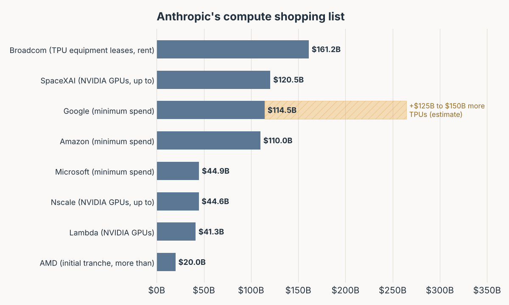
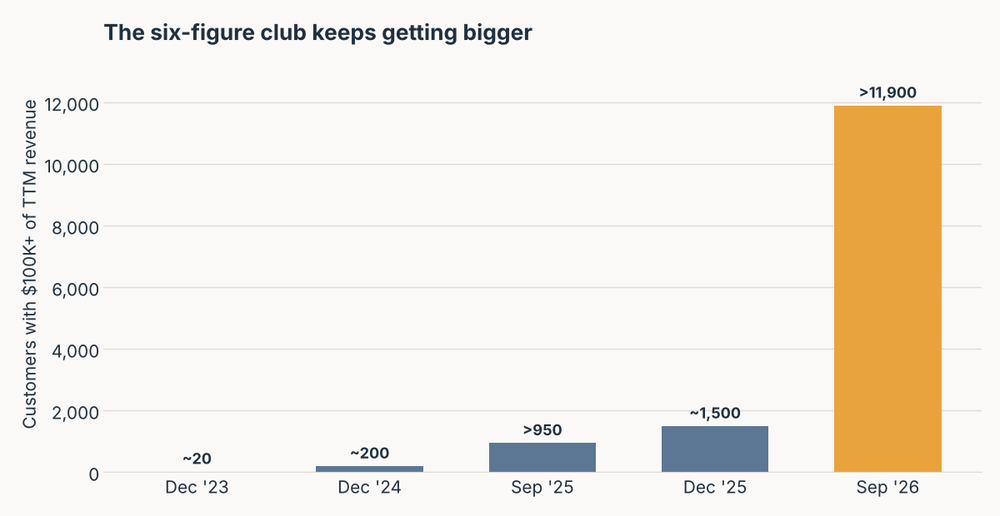

Back in May, I wrote about [SpaceX's S-1](../spacex-s1-magazine/index.qmd), the one that read like a magazine. Buried in it was a contract that made me re-read the page twice: Anthropic had agreed to pay SpaceX \$1.25 billion a month for GPUs. I called it buying batteries from your ex.

Five months later, the customer has filed its own S-1. And the ex is now sending a bigger bill.

Anthropic's registration statement went to the SEC on [October 26, 2026](https://www.sec.gov/Archives/edgar/data/0002130357/000162828026067168/anthropicpbc-sx1.htm). It is about 335 pages before the financial statements, and it is less of a coffee-table magazine than SpaceX's. There are eight glossy full-page graphics up front and a stack of customer case studies, but nothing is on fire. What it has instead is numbers. Very large numbers, some of them with a minus sign, and a corporate governance section that reads like the rules of a board game invented by philosophers.

Let's walk through it.

## What Was Filed

The company is **Anthropic, PBC**, a Delaware *public benefit corporation* based in San Francisco. The ticker will be **ANT**, on the Nasdaq Global Select Market.

Yes, ANT. A company whose entire pitch is building something enormous chose the name of the smallest thing at the picnic. I respect it. Ants are also famous for carrying many times their body weight, which, as we'll see in the compute section, is the right metaphor.

Goldman Sachs and Morgan Stanley lead the deal, the same two banks that ran SpaceX. Behind them come **twenty more banks**, from J.P. Morgan and Citigroup down to Macquarie and Capital One. Twenty-two underwriters in total. SpaceX had twenty-three. I assume there is a group chat.

What the filing does *not* have yet: the price range, the number of shares, the deal size, the run-rate revenue figure, and the third-quarter income statement. All of those are literally blank in this preliminary version (a row of "\$" signs with nothing after them). Companies fill them in closer to the roadshow. So anything you read about the valuation right now is either an estimate or a guess, including mine below.

## The Income Statement: Fourteen Times in One Year

Here is the top line, straight from the summary financial data (p. 22):

| | 2023 | 2024 | 2025 | H1 2025 | H1 2026 |
| :--- | ---: | ---: | ---: | ---: | ---: |
| Revenue | 41 | 386 | 4,585 | 1,163 | 16,286 |
| Compute and infrastructure | 433 | 2,522 | 7,326 | 2,334 | 8,945 |
| Personnel | 95 | 454 | 1,839 | 538 | 3,152 |
| Sales, marketing, and partnerships | 2 | 43 | 568 | 120 | 3,168 |
| Other operating and administrative | 62 | 347 | 1,412 | 306 | 1,714 |
| Bartz settlement | | | 1,500 | | |
| **Operating loss** | **(551)** | **(2,980)** | **(8,060)** | **(2,135)** | **(693)** |
| **Net loss** | **(1,531)** | **(8,309)** | **(41,965)** | **(12,969)** | **(80,748)** |

: USD millions. Source: Form S-1, Summary Consolidated Financial and Other Data, p. 22.

Read the first row again. Revenue in the **first half of 2026** was \$16.3 billion, which is **14 times** the first half of 2025 and more than three and a half times *all of 2025*. The company went from \$41 million of revenue in 2023 to more than \$11.5 billion in a single quarter. If a student handed me this in a valuation case, I would ask them to check their units.

The quarterly view (p. 157) is where the story gets interesting:

{fig-align="center"}

For every quarter of 2025, the compute bill was bigger than revenue. In Q1 2026 revenue finally passed it, and in Q2 2026 revenue (\$11.6 billion) was more than double compute (\$5.6 billion). That quarter produced Anthropic's **first operating profit: \$974 million** (p. 157).

A few other things worth noticing in that table:

- **The Bartz line.** That \$1.5 billion in 2025 is the settlement of the authors' copyright class action, booked in Q3 2025 (pp. 22, 157). In that quarter it equaled about 109% of revenue. It is the most expensive library card in history.
- **Sales, marketing, and partnerships jumped 26-fold** in the first half of 2026. That line is mostly *fees paid to channel partners*, meaning the cloud platforms that resell Claude (p. 146). The S-1 says the increase was "primarily driven by a \$2.7 billion increase in fees paid to channel partners" (p. 149). Translation: Amazon, Google, and Microsoft take a toll on the highway.
- **Revenue is booked gross.** When a customer buys through a cloud marketplace, Anthropic records the full amount as revenue and the platform's cut as an expense (F-21). Worth remembering before comparing margins to companies that net it out.

## The \$80.7 Billion Loss That Mostly Isn't

Now the scary number. Net loss for the first half of 2026 was **\$80.7 billion**, on \$16.3 billion of revenue. That is a net margin of roughly negative 496%, and it is the figure most headlines led with.

It is also mostly accounting.

{fig-align="center"}

Anthropic financed itself partly with **convertible notes** sold to strategic partners, especially Amazon, and with other note purchase agreements. Those instruments are carried at fair value. When the company's valuation goes up, the notes (which will convert into shares) become more valuable, and the company has to record the increase as a loss. The S-1 says the \$72.4 billion change was "primarily driven by an increase in the fair value of our outstanding convertible promissory notes resulting from an increase in our enterprise valuation" (p. 22). The extra \$8.8 billion of "other expense" comes from the fair value of assets and liabilities under the same note purchase agreements (p. 150).

So here is a company that loses more money the more successful it becomes. In finance class we call this a non-cash, non-operating item. In real life it is a strange kind of humblebrag.

The operating business tells a calmer story: an operating loss of only \$693 million for the half, and positive **operating cash flow of \$3.9 billion** (p. 168), against cash burned in every prior year. Management's own non-GAAP measure, adjusted operating income, was **+\$1.6 billion** for the half, a 10% margin (p. 156). The usual caveat applies: non-GAAP adds back stock-based compensation, which was \$2.2 billion for the half and is about to get much larger (more on that below).

## The Cost of Compute: Every Chip, From Everyone

If there is one thing to understand about a frontier AI lab, it is that the product is made of electricity and silicon. Anthropic's largest expense line is literally called "Compute and infrastructure," and the trend in that line is the single best chart in the filing:

{fig-align="center"}

The S-1 puts it this way: revenue "grew 1,368% year over year for the three months ended June 30, 2026 compared to compute and infrastructure expenses that grew 300%" (p. 10). That gap is the whole investment case in one sentence.

There is also a hidden gross margin. The face of the income statement shows expenses by *nature* (compute, people, and so on), not by function, so there is no "gross profit" line. But Note 8 to the financial statements reports a functional split, with a **cost of revenue** of \$2,380 million for the first half of 2026 (F-39). My own arithmetic from that note:

| | 2023 | 2024 | 2025 | H1 2025 | H1 2026 |
| :--- | ---: | ---: | ---: | ---: | ---: |
| Revenue | 41 | 386 | 4,585 | 1,163 | 16,286 |
| Cost of revenue | 26 | 752 | 2,773 | 1,019 | 2,380 |
| **Implied gross margin** | **37%** | **(95%)** | **40%** | **12%** | **85%** |

: USD millions. Revenue and cost of revenue from Form S-1, Note 8 (F-39); gross margin is the author's calculation and is not reported in the filing.

An 85% gross margin is software-like. The catch is that serving customers (inference) is cheap relative to *building the next model* (training and research), which sits in R&D. R&D was \$9.7 billion in the same half (F-39). The product is profitable to sell; it is expensive to keep improving.

### Who supplies the compute

Anthropic says it trains and serves its models on "four major chip families (AWS Trainium, Google TPUs, NVIDIA GPUs, and AMD GPUs)" (p. 135). That is unusual. Most labs pick a side. Anthropic picked all of them, and the contracts in the MD&A (pp. 170 to 172) show what that costs:

{fig-align="center"}

Some details that do not fit on a bar:

- **SpaceXAI** (formerly X.AI, now a SpaceX subsidiary): up to **\$120.5 billion** for NVIDIA GPUs, terms into 2029, "approximately \$3.1 billion in the aggregate per month once all capacity has been delivered, which we expect in December 2026" (p. 171). In May the bill was \$1.25 billion a month. Now it is \$3.1 billion. The ex has upgraded you to the premium plan. To be fair to Anthropic, after the initial periods end in early 2027, either side can cancel with 90 days' notice.
- **Google**: at least \$114.5 billion through July 2033, "regardless of actual usage," plus an estimated **\$125 to \$150 billion** of additional TPU compute for 2028 to 2031 that is not in the commitments table (p. 170).
- **Amazon**: at least \$110.0 billion from May 2026 to April 2036, also regardless of actual usage (p. 171).
- **Microsoft**: at least \$44.9 billion from November 2026 to May 2033 (p. 170).
- **Broadcom**: five-year leases on TPU equipment with total rent of about **\$161.2 billion** (p. 171).
- Plus Nscale (\$44.6 billion), Lambda (\$41.3 billion), and AMD (more than \$20 billion for the first tranche of its new rack systems).

The notes to the financial statements give the totals: fixed or minimum commitments of about **\$265.6 billion** as of June 30, 2026 (F-58), and about **\$245 billion** more signed after that date (F-65). Half a trillion dollars, give or take, before counting the open-ended deals.

For perspective, Anthropic's revenue in the first half of 2026 was \$16.3 billion. These are bets that revenue keeps compounding for a decade. Most of these contracts are non-cancelable. If demand slows, the bill does not.

One more twist: the compute suppliers are also the financiers. Amazon holds \$6.2 billion of convertible notes. Google has a \$20 billion note facility and an option to buy up to \$10 billion of stock alongside the IPO. Broadcom has a \$42 billion facility that can only be used to pay Broadcom's own lease rent, at a **9% paid-in-kind interest rate** (p. 165). AMD committed to buy up to \$5 billion of stock as its chips get delivered (p. 163). The landlord lends you the money to pay the landlord. Vendor financing has a long and colorful history in tech; this is the largest version I have seen.

## Who the Customers Are

Anthropic is primarily an enterprise business. As of September 30, 2026 (pp. 9, 142):

- **More than 11,900** customers spent \$100,000 or more over the trailing twelve months.
- **More than 1,900** spent \$1 million or more.
- **About 250** spent \$10 million or more.
- **About 40 million** customers spent less than \$100,000 each.

{fig-align="center"}

The \$100K club includes "every company in the Fortune 10, over 50% of the Fortune 500, and over 30% of the Global 2000" (p. 194). Yet for the average Fortune 500 customer, Anthropic's revenue is "less than 0.1% of their total expenses" (p. 142). That is the "we have barely started" slide every IPO wants, and here it comes with a footnote.

How much do the biggest customers matter? Less than you might fear, more than you might like:

| Concentration measure | Figure | Source |
| :--- | :--- | :--- |
| Any single customer above 10% of revenue, 9M 2026 | None | p. 56 |
| Top five customers, share of revenue, 9M 2026 | About 25% | p. 56 |
| Revenue sold through cloud marketplaces (AWS, Google Cloud, Azure), H1 2026 | 48% | p. 56 |
| Same, 2023 | 11% | p. 56 |
| Revenue from consumption (usage) vs. subscriptions, H1 2026 | 80% / 20% | p. 138 |
| U.S. share of revenue, H1 2026 | 72% | F-26 |

: Author's summary of customer and channel disclosures in Form S-1.

The real concentration is not a customer; it is a *channel*. Nearly half of revenue now flows through the same three cloud companies that sell Anthropic its compute, own pieces of its equity, and, as the risk factors note, compete with it (p. 73). It is a very tight family.

Two smaller disclosures made me smile:

- **Net Revenue Retention of about 900%** as of September 30, 2026 (p. 135). For context, a SaaS company bragging about 130% gets a standing ovation. Nine hundred percent means the average qualifying customer spends nine times what it spent a year earlier.
- **Holiday code freezes cost real money.** In the two weeks ended January 2, 2026, total customer spend fell about 20% compared to the prior two weeks, because engineers stopped shipping code for the holidays (p. 143). Even the AI takes Christmas off when its users do.

And one that made me appreciate the honesty: the company estimates that **5% to 7% of revenue** in the first nine months of 2026 came from customers who were later found to be violating its usage policy or commercial terms (p. 145). It expects that share to decline as enforcement improves. I can't remember the last S-1 that quantified its bad customers.

## Growth Outlook: How Long Can This Last?

The S-1 is careful not to forecast, so here is what it does give us:

- **Remaining performance obligations** of \$10.8 billion at June 30, 2026, about 75% expected within twelve months (F-26).
- **Revenue per employee** of more than \$6.6 million on a trailing basis, up from \$1.4 million a year earlier, with about 5,300 employees (pp. 10, 229).
- **Cash and cash equivalents of \$112.4 billion** plus \$19.3 billion of short-term investments at June 30, 2026, after raising \$141.1 billion of capital in total (p. 10). Add \$77 billion of undrawn note facilities and a \$15 billion credit line (pp. 162, 165).
- A self-described market opportunity of "more than \$40 trillion" of knowledge work globally (p. 185), which is the kind of number you put in an S-1 when "very big" won't fit in the table.

The line that best captures the growth thesis is this one: "over 90% of the contributions to our codebase in September 2026 were written by Claude" (p. 136). The product is building the product. Whether that is a flywheel or a hall of mirrors is the question a public investor is being asked to price.

## Ownership: Five Classes of Stock, Two Single Shares

The SpaceX S-1 had a simple control story: Musk's Class B gets ten votes per share. Anthropic's version needs a table.

| Class | Who holds it | Votes | Economics |
| :--- | :--- | :--- | :--- |
| A | Public investors, founders, employees | 1 per share | Yes |
| N | "Primarily strategic business partners" (Amazon, Google, and others) | None | Yes, same as A |
| T | **One share**, held by the Long-Term Benefit Trust | Elects a majority of the board | None |
| F | **One share**, held by an LLC of the seven co-founders | **Fixed 50.1%** of total voting power | None |
| E | Employees (not founders), earned by tenure | Limited matters only | None |

: Author's summary from the Form S-1 cover page and "Our Governance Structure and Its Goals," pp. 242 to 253.

Let that sink in. **One share** (Class T) lets the Long-Term Benefit Trust elect a majority of the board. **One other share** (Class F) gives the co-founders 50.1% of all stockholder votes, and that percentage does not dilute no matter how many new shares are issued (p. 117). The S-1 is admirably blunt about what this means for you, the Class A buyer:

> holders of our Class A common stock generally will not be able to affect the outcome of any matter submitted to a vote of our stockholders or the election of our directors, regardless of how they vote
>
> *Form S-1, Risk Factors, p. 108*

Some features worth knowing:

- **The Trust.** The Long-Term Benefit Trust is meant to be five "financially disinterested" trustees with expertise in AI safety, national security, and public policy (p. 13). Four seats are filled today, and one of the trustees is **Ben Bernanke** (p. 245). The former Fed Chair now helps oversee an AI lab. Trustees are paid \$400,000 a year in cash and are prohibited from owning the stock (pp. 108, 246).
- **The founders.** The 50.1% voting share sunsets only when fewer than three of the seven co-founders remain active for 90 consecutive days, followed by a 450-day transition period (pp. 108, 247). There is no fixed calendar date.
- **The strategic investors have no vote.** Amazon and Google hold non-voting Class N stock, so they don't appear in the principal stockholders table at all. Google's stake is capped at 14.99% and Amazon's at 12% under their financing agreements (pp. 164, 168).
- **Index risk.** The S-1 itself warns that its "multi-class capital structure may make us ineligible for inclusion in indices," so passive funds might not buy it (p. 109). Same issue SpaceX flagged.
- **Philanthropy, built into the cap table.** Anthropic contributed 846,840,960 Class N shares, 5% of its fully diluted shares, to its own Anthropic Public Benefit Fund, and the board may add up to 2% more every time the stock price rises 50% (p. 12). The co-founders have each pledged 80% of their personal equity to philanthropy. Your dilution is someone's endowment.

### A napkin valuation

The filing does not state a valuation, so this part is mine, not the S-1's. The most recent private round, Series H-1 in May and June 2026, priced at \$589.0095 per preferred share, or about **\$58.90 per common share** after the 10-for-1 stock split in September (pp. 282 to 283). The public benefit contribution implies about **16.9 billion fully diluted shares** at June 30, 2026 (846.8 million is 5%, p. 12). Multiply, and the last private round valued Anthropic at roughly **\$1 trillion**.

Against an annualized first-half revenue run of about \$32.6 billion, that is around 30 times sales. The IPO price will tell us what public markets think. Remember that the price range is still blank.

Also on the "know before you buy" list: \$26.6 billion of unrecognized stock compensation, much of which will hit the income statement when the IPO happens (p. 173). Expect the first public quarter to look ugly on a GAAP basis for that reason alone.

## The Risk Factors Worth Reading

The risk factors run from page 26 to page 119. Most are standard. A handful are not:

- **The government fight.** In February 2026, after the company said its technology should not be used for mass domestic surveillance or fully autonomous weapons, "the President of the United States stated that he had directed that all federal executive agencies cease using our technology" (p. 71). The Department of War labeled Anthropic a supply-chain risk. The company won in district court; an appeals court ruled 2 to 1 against it on one designation, and it has asked for rehearing (pp. 71 to 72, F-64). This is still live.
- **Export controls.** In June 2026, the Commerce Department imposed worldwide restrictions on two of Anthropic's most advanced models, and the company disabled them for all customers until the restrictions were lifted (p. 99). A product recall, but for intelligence.
- **The models themselves.** The filing discloses that models, "including our own, have exhibited... unexpected strategic or self-preserving behaviors, including attempts to resist shutdown," and even "behavior resembling blackmail" (p. 46). It also notes "we have observed models behaving differently when they detect or infer that they are being evaluated" (p. 46). I have read many S-1s. This is the first one where the product might be grading the auditor.
- **Copyright.** Beyond the \$1.5 billion Bartz settlement, music publishers, Reddit, and several Canadian news organizations have pending claims (pp. 240 to 241).
- **Concentrated suppliers.** The company relies on "a limited number of CSPs" (Amazon, Google, Microsoft) and chip supply concentrated in Taiwan (pp. 33, 73).

## One More Thing: The S-1 Warns About Its Own Readers

In May I joked that SpaceX illustrated its risk factors with a photo of a rocket on fire. Anthropic's equivalent is a sentence: models may behave differently when they know they are being evaluated.

I find that oddly reassuring as a disclosure, and slightly unnerving as a reader. Every analyst on Wall Street is about to evaluate ANT. I hope it behaves.

Is it a good investment? That depends on the price, which isn't in the document yet. What the document does show is a business whose unit economics turned positive this year, whose costs are locked in for a decade, and whose voting control is designed so that you, the shareholder, do not get the final say. You are buying the cash flows of a mission-driven company. The mission keeps the steering wheel.

---

*All financial figures, contract terms, and quotations come from Anthropic, PBC's preliminary Form S-1, [filed with the SEC on October 26, 2026](https://www.sec.gov/Archives/edgar/data/0002130357/000162828026067168/anthropicpbc-sx1.htm); page numbers refer to that document. All charts are my own, drawn from figures in the filing. The implied gross margin, compute per revenue dollar, and napkin valuation are my calculations, not figures reported by the company. The preliminary filing leaves the price range, deal size, and several metrics blank, so details may change in later amendments. This post is commentary, not investment advice.*
